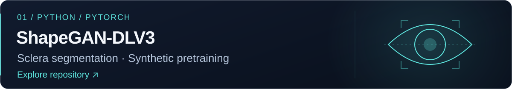
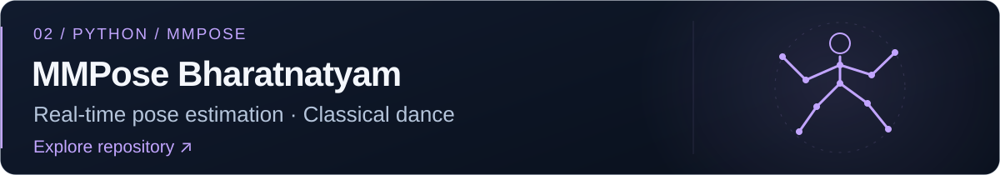
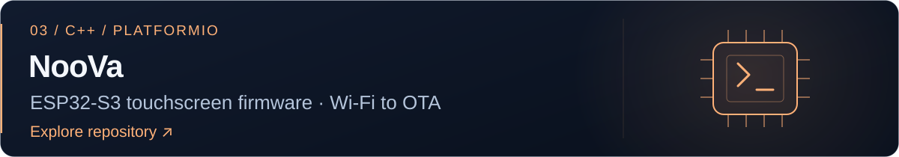
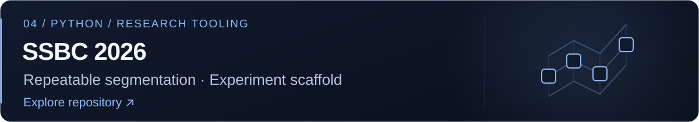

  

  <a href="https://www.linkedin.com/in/hariohm-bhatt-519552237/">LinkedIn&nbsp;↗</a> &nbsp; · &nbsp;
  <a href="mailto:bhatthariohm2004@gmail.com">Email&nbsp;↗</a> &nbsp; · &nbsp;
  <a href="https://github.com/HariohmBhatt?tab=repositories">Repositories&nbsp;↗</a>

### Selected work

  <strong>On my workbench</strong> 
  Python · PyTorch · C++ · ESP32 · Flutter

