  <picture>
    <source media="(prefers-color-scheme: light)" srcset="assets/profile-banner-light.svg" />
    
  </picture>

  I build computer vision models for medical and scientific imaging, especially where labels are scarce, and the pipelines that make them dependable.

  <a href="https://www.linkedin.com/in/hariohm-bhatt-519552237/">LinkedIn&nbsp;↗</a> &nbsp; · &nbsp;
  <a href="mailto:bhatthariohm2004@gmail.com">Email&nbsp;↗</a>

  <picture>
    <source media="(prefers-color-scheme: light)" srcset="assets/vision-banner-light.svg" />
    
  </picture>

  <picture>
    <source media="(prefers-color-scheme: light)" srcset="assets/learning-banner-light.svg" />
    
  </picture>

  <picture>
    <source media="(prefers-color-scheme: light)" srcset="assets/systems-banner-light.svg" />
    
  </picture>

  <picture>
    <source media="(prefers-color-scheme: light)" srcset="assets/tools-banner-light.svg" />
    
  </picture>

