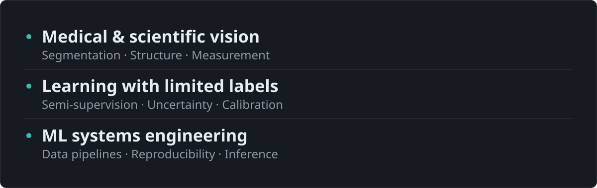

<picture>
  <source media="(prefers-color-scheme: light)" srcset="assets/profile-banner-light.svg" />
  
</picture>

I build computer vision models for medical and scientific imaging, especially where labels are scarce, and the pipelines that make them dependable.

<picture>
  <source media="(prefers-color-scheme: light)" srcset="assets/focus-banner-light.svg" />
  
</picture>

**Tools** · Python · PyTorch · OpenCV · FastAPI · Docker 
**Contact** · [LinkedIn](https://www.linkedin.com/in/hariohm-bhatt-519552237/) · [Email](mailto:bhatthariohm2004@gmail.com)
